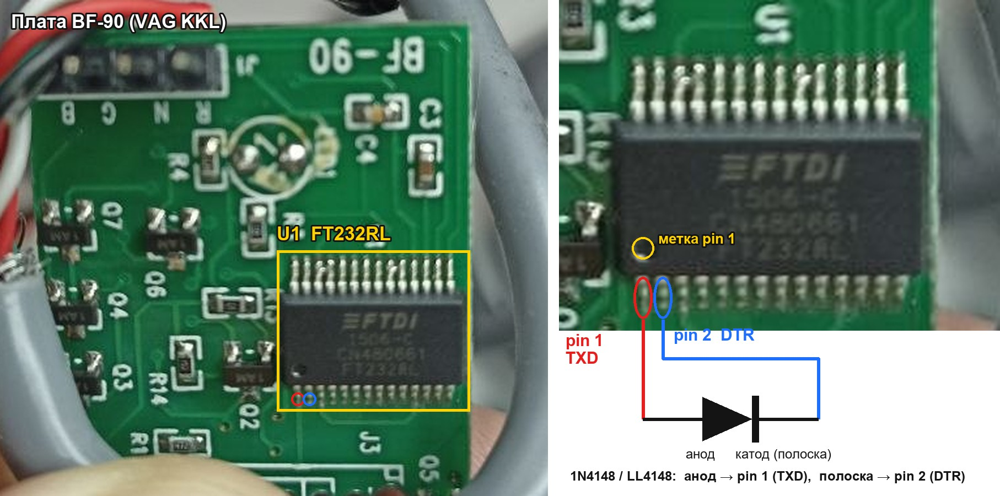

# kkl2galletto

**Обычный кабель VAG KKL на FT232 работает как Galletto 1260, без пайки.**

Как превратить дешёвый кабель VAG KKL (VAG-COM 409.1, FT232RL) в рабочий кабель для **Galletto 1260 / New Serial 1260 (EOBD1260.exe)**:

1. Перепрошиваем EEPROM чипа FT232 в бесплатной программе FTDI FT_Prog.
2. Вместо диода TXD–DTR, который паяют на FT232, патчим `FTD2XX.dll` скриптом из этого репозитория: меняются 4 байта.

> 🇬🇧 *English summary at the bottom.*

---

## ✅ Проверено

| | |
|---|---|
| Автомобиль | Mercedes-Benz Vito W638 2.2 CDI |
| ЭБУ | Bosch **0281010436** / MB **A 611 153 00 79**, EDC15C0 (CR1.7), Flash 29F400 |
| Профиль Galletto | `MERCEDES → BOSCH EDC 15 C5 E2 29F400BT → Mercedes Vito 2.2 CDI` |
| Кабель | VAG KKL, плата BF-90, FT232RL (клон, PID был 0000) |
| ОС | Windows 10 x64 |
| Результат | чтение 512 КБ за ~90 с, 5 чтений подряд совпали байт в байт; запись прошла, контрольное чтение после записи совпало с записанным файлом |

Работать должно и с другими блоками, которые Galletto 1260 поддерживает по K-линии, но проверен только этот. Если проверите на своём, напишите в Issues.

---

## ❓ Почему обычный KKL не работает с Galletto

| Проблема | Симптом | Решение |
|---|---|---|
| Galletto ищет адаптер **по серийному номеру FTDI `47514789`** через D2XX (`FT_OpenEx`). COM-порт не используется и не выбирается | `Opening port impossible` | FT_Prog: Serial = `47514789` |
| Нужен стандартный **PID `6001`**. У поддельных FT232RL драйвер FTDI 2014 года записывал PID `0000` | то же | FT_Prog: PID = `6001` |
| Galletto будит ЭБУ, переключая **DTR**. В кабеле Galletto DTR через диод прижимает TXD (K-линию) к нулю. В VAG KKL DTR никуда не подключён | ECU Data: `00 00 00…`, `errore data2` | **патч DLL** (или диод) |

---

## 📦 Что нужно

- Кабель **VAG KKL на FT232** (FT232RL/FT232BL). ⚠️ Кабели на **CH340 не подходят**: Galletto работает только через драйвер FTDI D2XX.
- Ваш комплект **Galletto 1260 / New Serial 1260** (EOBD1260.exe) с `FTD2XX.dll` в его папке. *Программы в репозитории нет.*
- [FT_Prog](https://ftdichip.com/utilities/) с официального сайта FTDI.
- [Python 3](https://www.python.org/) (только чтобы запустить скрипт патча).
- Блок питания 12–13,5 В для работы на столе.

---

## 🛠 Шаг 1. FT_Prog: PID и серийный номер

Все программы, работающие с кабелем, закрыть. Питание на ЭБУ не нужно.

1. KKL в USB → `FT_Prog.exe` от имени администратора.
2. **Devices → Scan and Parse**.
3. **Сделайте бэкап:** File → Save Template As → `KKL_original.xml`.
4. **USB Device Descriptor** → **Product ID** = `6001` (Vendor ID `0403` не трогать).
5. **USB String Descriptors**:
   - Manufacturer: `FTDI`
   - Product Description: **`EOBD2`**
   - **Auto Generate Serial No: снять галочку**
   - Serial Number Enabled: ✔
   - Serial Number: **`47514789`**
6. Больше ничего не менять.
7. ⚡ **Program Devices** → **Program** (не Erase).
8. Переподключите кабель, снова Scan and Parse и проверьте значения.

После этого в Galletto должна появиться надпись **USB Device Active**.

> Если FT_Prog не записывает EEPROM (на клонах бывает), попробуйте FTDI MProg 3.5.

---

## 💡 Шаг 2. «Диод» программно: патч FTD2XX.dll

### Как это работает

Galletto управляет K-линией только функциями `FT_SetDtr` / `FT_ClrDtr`, без bit-bang. У FT232 есть штатная команда **break** (`FT_SetBreakOn` / `FT_SetBreakOff`), которая прижимает TXD к нулю, то есть делает то же, что диод. Скрипт меняет в **таблице экспорта** `FTD2XX.dll` два адреса:

```
FT_SetDtr  ->  FT_SetBreakOn    (K-линия = 0)
FT_ClrDtr  ->  FT_SetBreakOff   (K-линия отпущена)
```

- Меняются **4 байта**, код DLL не трогается.
- Патчится только **копия DLL в папке Galletto**. Системный драйвер FTDI, VCDS и другие программы работают как раньше.
- Оригинал сохраняется как `FTD2XX_original.dll`, откат одной командой.

### Запуск

```bat
python patch_ftd2xx.py "C:\путь\к\GALLETTO_1260"
```

или перетащите папку Galletto на `patch_ftd2xx.bat`.

| Команда | Что делает |
|---|---|
| `python patch_ftd2xx.py <папка>` | патч (с бэкапом оригинала) |
| `python patch_ftd2xx.py <папка> --check` | показать, пропатчена ли DLL |
| `python patch_ftd2xx.py <папка> --restore` | вернуть оригинал |

Проверено на `FTD2XX.dll` **3.01.06** (81 920 байт) из комплекта Galletto 1260. Скрипт сам находит функции по именам, поэтому должен работать и с другими 32-битными версиями.

### Альтернатива: диод паяльником

Если хотите, чтобы кабель работал без патча:



- Диод **1N4148** (или SMD LL4148) на ножки **FT232RL** (SSOP-28):
  - **pin 1 (TXD)**: анод (конец **без** полоски)
  - **pin 2 (DTR#)**: катод (конец **с** полоской)
- Pin 1: надпись на чипе читается ровно, нижний ряд, крайняя левая ножка у круглой метки.
- После пайки проверьте, что pin 2 и pin 3 не замкнуты.

⚠️ **Либо диод, либо патч, не оба сразу.** С диодом используйте оригинальную DLL.

---

## 🔌 Подключение на столе (пример: Vito W638, 0281010436)

| Вывод ЭБУ | Назначение |
|---|---|
| T1-1, T1-7 | +12 В |
| T1-5 | масса |
| T2-13 | +12 В через выключатель (**зажигание**) |
| T3-28 | K-line |

| Контакт OBD кабеля KKL | Назначение |
|---|---|
| 16 | **+12 В** (без этого узел K-линии в кабеле не работает) |
| 4, 5 | масса, общая с ЭБУ |
| 7 | K-line |

⚠️ Распиновку всегда сверяйте с номером своего блока. Например, у 0281011152 вместо T1-7 используется T1-8. Резисторы boot на Flash для этого способа не нужны.

---

## 📖 Чтение

1. `EOBD1260.exe` **от имени администратора** → **USB Device Active**.
2. Выбрать марку, драйвер и модель.
3. Подать питание и зажигание, подождать 10 с → **ECU Data**. Должны появиться номера блока.
4. **FLASH** + **COMPLETE** → **Read ECU**.
5. ⚠️ **Путь файла впишите вручную** (например `D:\ECU\read1`) и сразу нажмите «Сохранить». **Не листайте папки в этом окне**: на Windows 10 старая 32-битная программа виснет и падает (`0xc06d007e`).
6. `TURN OFF AND TURN ON THE DASHBOARD`: выключить и включить зажигание → **OK**.
7. Окно будет «не отвечать», это нормально, ждите (~90 с на 512 КБ).
8. `END OF READ. TURN OFF THE DASHBOARD` → выключить зажигание → **OK**. Только после этого файл записывается на диск.
9. Прочитайте **дважды** и сравните:

```bat
certutil -hashfile D:\ECU\read1 SHA1
certutil -hashfile D:\ECU\read2 SHA1
```

## ✍️ Запись

1. Файл того же размера, **контрольные суммы пересчитаны** (WinOLS и т.п.). Не рассчитывайте, что Galletto сделает это сам.
2. Стабильное питание, ноутбук на зарядке, сон выключен.
3. **Download File** → файл → запросы зажигания выполнять сразу → дождаться `Closing ECU...OK`.
4. `Spegnere il quadro per 10 secondi` по-итальянски: «выключите зажигание на 10 секунд».
5. Прочитайте блок и сравните хэш с записанным файлом.

---

## 🚑 Ошибки

| Сообщение | Причина | Что делать |
|---|---|---|
| `Opening port impossible` | не тот серийник/PID, кабель занят | Шаг 1, закрыть другие программы |
| ECU Data `00 00…`, `errore data2` | ЭБУ не проснулся | Шаг 2; +12 В на OBD-16; проверить K-line |
| `changing speed error` | разовый сбой смены скорости | снять питание с ЭБУ на 30 с, повторить |
| `Writing initialization errore data2` на 0% | не вошёл в режим записи, Flash **не тронут** | прочитать и сравнить с оригиналом, повторить |
| падение в окне «Сохранить» | расширения проводника в 32-битном процессе | вписывать путь вручную; режим совместимости Windows XP SP3 |
| EEPROM неактивен | профиль читает только Flash | EEPROM читать программатором |

---

## ⚠️ Отказ от ответственности

- Проект **не содержит** программу Galletto, драйверы и DLL FTDI или прошивки ЭБУ. Используйте свой легально полученный комплект.
- Скрипт меняет только копию `FTD2XX.dll` в папке программы и сохраняет оригинал.
- Работа с ЭБУ может вывести блок из строя. **Всегда сохраняйте проверенную копию оригинальной прошивки** (минимум два совпавших чтения). Всё делаете на свой риск.
- Изменение ПО ЭБУ может противоречить законам вашей страны о дорожном движении и экологии.

FTDI, FT232, FT_Prog — товарные знаки Future Technology Devices International Ltd. Galletto — торговое название соответствующего продукта. Проект с ними не связан.

---

## 🇬🇧 English summary

Make a cheap **FT232-based VAG KKL cable** work with **Galletto 1260 / New Serial 1260** without soldering:

1. **FT_Prog**: set PID `6001`, Product Description `EOBD2`, Serial `47514789` (untick *Auto Generate Serial*). Galletto opens the adapter via D2XX by this serial.
2. **No-diode patch**: Galletto wakes the ECU by toggling **DTR**. Original Galletto cables have a diode from DTR to TXD; KKL cables don't (symptom: `errore data2`, zeros in ECU Data). `patch_ftd2xx.py` redirects the export table entries of the `FTD2XX.dll` in the Galletto folder: `FT_SetDtr → FT_SetBreakOn`, `FT_ClrDtr → FT_SetBreakOff`. A UART break pulls TXD/K-line low, exactly what the diode does. Four bytes changed, original backed up, `--restore` to undo.

Hardware alternative: 1N4148 between FT232RL **pin 1 TXD (anode)** and **pin 2 DTR# (cathode)**. Use either the diode or the patch, not both.

Tested: Mercedes Vito W638 2.2 CDI, Bosch 0281010436 (EDC15C0), profile *BOSCH EDC 15 C5 E2 29F400BT*: 512 KB read in ~90 s, repeated reads identical, write + read-back verified.

Tips: type the file path manually in the save dialog (browsing folders crashes the old app on Win10); "not responding" during read/write is normal.

## License

[MIT](LICENSE)
